# 医学影像智能分析平台 (核心流程验证版)

面向单个医生使用的轻量级医学影像智能分析核心流程。无需配置庞大的云端数据库和复杂微服务，采用纯 Python 本地文件流与标准化算法管道，实现：
**DICOM 影像读取 $\rightarrow$ 3D 深度学习病灶识别 $\rightarrow$ 国际标准影像组学 (PyRadiomics) 特征提取与计算 $\rightarrow$ 大模型临床洞察 Payload 组装**。

---

## 一、 系统架构与流程图

```mermaid
flowchart LR
    A["1. DICOM 序列目录\n(268 层肺部 CT)"] --> B["SimpleITK / pydicom\n几何校准与体数据解析"]
    B --> C["标准 3D NIfTI 体数据\n(lung_ct_volume.nii.gz)"]
    C --> D["2. 3D nnU-Net 病灶推理\n(Dataset712 深度学习模型)"]
    D --> E["三维病灶分割 Mask\n(sample_case.nii.gz)"]
    E --> F["3. PyRadiomics 组学引擎\n(107 维 IBSI 国际标准特征)"]
    F --> G["结构化组学表格\n(radiomics_features.csv)"]
    G --> H["4. 大模型 Prompt 适配器\n(llm_insight_payload.json)"]
```



---

## 二、 核心技术栈与版本规格

| 模块 | 开源库 / 工具 | 锁定版本 | 职责与作用 |
| :--- | :--- | :--- | :--- |
| **基础运行环境** | Python / Miniconda3 | `3.11.18` | 保证 PyRadiomics C++ 扩展、SimpleITK 与 PyTorch 的最佳 ABI 兼容性 |
| **影像序列 I/O** | `SimpleITK` | `2.5.3` | 读取 DICOM 系列、空间分辨率对齐、HU 窗位映射、保存标准 NIfTI |
| **元数据解析** | `pydicom` | `3.0.2` | 解析 DICOM 标签（患者信息、层厚、扫描设备参数） |
| **3D 体数据读写** | `nibabel` | `5.4.2` | 标准 3D NIfTI 格式解析与转换 |
| **病灶识别算法** | `nnU-Net v2` | `2.8.0` | 3D Fullres 卷积神经网络，端到端分割肺部病灶 |
| **影像组学计算** | `pyradiomics` | `3.0.1` | 国际 IBSI 标准定量特征提取器（三维形状、一阶统计、灰度共生矩阵等） |
| **数据科学与形态学**| `numpy` / `scipy` / `pandas` | `1.26.4` / `1.17.1` / `2.2.3` | 三维连通域分析、特征矩阵重塑与表格化导出 |

---

## 三、 目录结构说明

```
medimaging-analysis/
├── src/
│   ├── dicom_io.py          # DICOM 序列读取与 3D NIfTI 转换模块
│   ├── lesion_detector.py   # 3D 深度学习病灶检测与连通域解析
│   ├── radiomics_engine.py  # PyRadiomics 国际标准定量特征提取与临床指标映射
│   ├── report_adapter.py    # 大模型 Prompt 模板生成与数据报文封装
│   └── __init__.py
├── scripts/
│   └── run_pipeline.py      # 一键端到端全流程运行脚本
├── outputs/                 # 验证输出产物
│   ├── lung_ct_volume.nii.gz   # 转换后的 3D 原始体数据
│   ├── segmentation/           # AI 识别出的病灶掩膜
│   ├── radiomics_features.csv  # 包含 42 维临床关键指标的表格
│   ├── radiomics_features.json # 包含 107 维完整组学特征的 JSON
│   └── llm_insight_payload.json# 为大模型准备的结构化 Prompt 报文
├── requirements.txt         # 核心 Python 依赖清单
└── README.md
```

---

## 四、 服务器执行方法

连接到 A100 服务器并在虚拟环境下运行：

```bash
# 1. 激活虚拟环境
source /data/miniconda3/etc/profile.d/conda.sh
conda activate medimaging-analysis

# 2. 运行核心流程验证脚本
python /data/medimaging-analysis/scripts/run_pipeline.py --gpu 2
```
